  

# 🛡️ Awesome Microsoft Entra ID Backup & Recovery ⚡

  
  
  
  
  
  

  <strong>A curated list of top Microsoft Entra ID Backup and Recovery solutions, platforms, and open-source tools.</strong> 
  Covering enterprise SaaS identity resiliency platforms, disaster recovery orchestration, and open-source PowerShell scripts for protecting directory objects, conditional access policies, application registrations, and hybrid identity configurations against accidental deletion, ransomware attacks, and misconfigurations.

  🌟 <strong>Star this repo if you find it useful!</strong> 🌟

---

## 📑 Table of Contents

- [📈 Sector Overview & Market Dynamics](#-sector-overview--market-dynamics)
- [🟦 SaaS & Commercial Hosted Platforms](#-saas--commercial-hosted-platforms)
- [🟩 Open-Source Tools & Utilities](#-open-source-tools--utilities)
- [📊 Feature Comparison Matrix](#-feature-comparison-matrix)
- [🛡️ Understanding the Shared Responsibility Model](#️-understanding-the-shared-responsibility-model)
- [❓ Frequently Asked Questions (FAQ)](#-frequently-asked-questions-faq)
- [⭐ Star History](#-star-history)
- [💖 Support & Sponsorship](#-support--sponsorship)
- [🤝 Contributing](#-contributing)
- [📄 License](#-license)

---

## 📈 Sector Overview & Market Dynamics

- 🌐 **Market Size & Trajectory:** The Microsoft Entra ID backup and identity resilience market sits at the convergence of Cloud Identity & Access Management (IAM) and SaaS Data Protection—sectors valued together between **$7.1 billion and $12.5 billion**, rapidly projected to surpass **$33 billion+ by the mid-2030s** at a CAGR of 15%–18%.
- 🧩 **Market Dynamics & Structure:** The sector is **moderately fragmented**, transitioning from legacy on-premises Active Directory forest recovery toward modern cloud and hybrid identity resilience. While multi-billion-dollar enterprise backup leaders (Veeam, Rubrik, Commvault) capture large portions of IT infrastructure budgets, specialized pure-play identity security and resilience providers (Semperis, Cayosoft, Keepit) maintain high differentiation in instant rollback, directory diff auditing, and granular Entra ID / hybrid Active Directory forest recovery.

---

## 🟦 SaaS & Commercial Hosted Platforms

The following enterprise SaaS platforms provide automated cloud backups, granular object and attribute restore, ransomware rollback, and disaster recovery orchestration for Microsoft Entra ID (formerly Azure Active Directory) and hybrid AD environments.

*Table sorted by company size (Valuation / Market Cap / Revenue) descending:*

| 🏢 Platform | 💰 Company Valuation / Revenue | 🏷️ Pricing (Starting Tier) | 🎁 Free Tier / Free Trial Limits | 🚀 Key Capabilities & Workloads |
| :--- | :--- | :--- | :--- | :--- |
| **[Veeam Backup for Entra ID](https://www.veeam.com/)** | **~$15.0B** valuation / **~$2.0B ARR** | **$2.00 / user / month** (billed annually at $24/yr for self-managed software); SaaS Veeam Data Cloud starts at **$2.63 / user / month** | **Free Community Edition:** Permanently free for up to **10 users**, 10 Microsoft Teams, and 1 TB SharePoint data (no expiration; community support) | 🔄 Item & properties restore for users, groups, administrative units, roles, applications, conditional access, and Intune policies. |
| **[Rubrik Identity Resilience](https://www.rubrik.com/)** | **~$13.9B** market cap (NYSE: RBRK) / **~$1.18B ARR** | **$3.00 – $6.00 / user / month** (tiered subscription baseline, custom enterprise quote) | **30-day free trial** (Rubrik-hosted SaaS trial limited to a maximum of **500 users** and capped backup volume) | 🌲 Orchestrated AD Forest Recovery + Entra ID unified rollback; rolls back malicious changes and rolls forward legitimate updates; identity restores first. |
| **[Commvault Cloud for Entra ID](https://www.commvault.com/)** | **~$6.5B** enterprise value (NASDAQ: CVLT) / **~$995M+ ARR** | **$1.70 / user / month** (Standard SaaS tier with 5 GB storage/user); Enterprise tier starts at **$3.60 / user / month** | **30-day free trial** (full access to Commvault Cloud SaaS backup for M365 and Entra ID directory workloads) | 📦 Automated daily backups of users, groups, roles, and conditional access policies; AirGap isolated immutable storage; unified hybrid AD + Entra ID recovery. |
| **[Quest On Demand Recovery](https://www.quest.com/products/on-demand-recovery/)** | **~$5.4B** valuation (acquired by Clearlake) / **~$850M+ revenue** | **$9.00 – $11.00 / user / year** (~$0.75 – $0.92 / user / month, based on public procurement listings) | **30-day free evaluation trial** (functional sandbox testing backup, item-level restoration, and diff reporting) | 🔍 Granular diff reports comparing backups to live Entra ID environments; bulk restore of users, groups, and attributes without PowerShell scripts. |
| **[AvePoint Cloud Backup](https://www.avepoint.com/)** | **~$3.0B** market cap (NASDAQ: AVPT) / **~$419M ARR** | **$1.50 – $3.00 / user / month** (standard SaaS backup tier depending on commitment and volume) | **30-day free trial** (standard evaluation environment supporting up to **5 users** with full restore and ransomware detection) | ☁️ Automatic backups and multi-year retention for 100% of Entra ID objects; flexible storage on AvePoint Azure or customer-owned cloud storage. |
| **[Semperis Directory Services Protector (DSP)](https://www.semperis.com/)** | **~$1.5B+** valuation / **~$100M+ ARR** | **Custom enterprise quote** (subscription scaled per protected identity/user account in hybrid AD/Entra ID) | **Free Assessment Tool:** Permanently free **Purple Knight** vulnerability scanner (audits hybrid AD/Entra ID indicators of exposure); bespoke enterprise PoC trial upon request | ⏱️ Real-time tracking and auditing of directory changes; non-destructive rollback; automated AD Forest Recovery (ADFR); reduces downtime up to 90%. |
| **[Druva Microsoft Entra ID Protection](https://www.druva.com/)** | **~$2.0B** valuation / **~$200M+ ARR** | **$8.00 / user / month** (baseline SaaS data protection tier; enterprise identity resiliency quote-based) | **30-day free trial** (access to cloud-native Entra ID autonomous protection and granular restore capabilities) | 🔐 Automated backups of users, groups, roles, and applications; granular restore from snapshots; Cloud Key Management integration. |
| **[Keepit for Entra ID](https://www.keepit.com/)** | **~$390M** valuation / **~$100M+ ARR** | **$1.95 – $2.95 / user / month** (Core Continuity tier; Enterprise tier starts at **$2.80 – $4.25 / user / month**) | **30-day free trial** (unlimited access to test automated backup and bulk recovery workflows) | 🛡️ Vendor-neutral, independent cloud backup; bulk restore for administrative units, PIM role assignments, Windows LAPS, and Intune policies. |
| **[HYCU for Entra ID](https://www.hycu.com/)** | **~$350M** valuation / **~$50M ARR** | **$1.20 / user / month** (Workforce Identity Suite protecting AWS IAM, Entra ID, and Okta) | **14-day free trial** (standard R-Cloud trial with platform fees waived; 30-day identity promotional trial often available) | ⚡ One-click restore for Entra ID tenant settings, conditional access policies, custom security attributes, and app registrations to customer-controlled S3 storage. |
| **[Cayosoft Guardian](https://www.cayosoft.com/)** | **~$100M+** valuation / **~$15M – $25M ARR** | **Custom enterprise quote** (subscription per managed user; no additional fees for number of admins, CPUs, or servers) | **Permanently Free Tier:** **Cayosoft Guardian Protector** (continuous threat detection & change monitoring); 30-day trial for Guardian Audit & Restore | 🔄 Continuous change monitoring across on-prem, hybrid, and cloud; immediate rollback of administrative mistakes; full forest ransomware recovery. |

---

## 🟩 Open-Source Tools & Utilities

The open-source ecosystem for Microsoft Entra ID provides modular scripting libraries, declarative configuration-as-code management, export utilities, and security governance tools. 

*Table sorted by GitHub Stargazers count descending:*

| 🛠️ Tool / Repository | ⭐ GitHub Stars | 💻 Technology / Language | 🎯 Core Purpose & Use Case | 📜 License |
| :--- | :---: | :--- | :--- | :---: |
| **[Microsoft365DSC](https://github.com/Microsoft365DSC/Microsoft365DSC)** |  | PowerShell | **Configuration-as-Code Backup & Drift Management:** Declaratively defines, manages, and monitors Microsoft 365 and Entra ID configurations, detecting configuration drift and restoring desired state policies. | MIT |
| **[Azure-MG-Sub-Governance-Reporting (AzGovViz)](https://github.com/JulianHayward/Azure-MG-Sub-Governance-Reporting)** |  | PowerShell | **Governance & RBAC State Snapshot:** Captures granular Azure tenant, Entra ID RBAC assignments, Azure Policies, and management group structures via Azure ARM and Microsoft Graph API. | MIT |
| **[msgraph-sdk-powershell](https://github.com/microsoftgraph/msgraph-sdk-powershell)** |  | PowerShell / C# | **Custom Graph Export & Restore SDK:** Official Microsoft Graph PowerShell SDK used to write custom extraction, backup, and restore pipelines for users, groups, app registrations, and directory settings. | MIT |
| **[microsoft/EntraExporter](https://github.com/microsoft/EntraExporter)** |  | PowerShell | **Automated JSON Tenant Export:** Official Microsoft PowerShell module to export local JSON copies of tenant configurations, conditional access, and app registrations into Git for version tracking. | MIT |
| **[M365Documentation](https://github.com/ThomasKur/M365Documentation)** |  | PowerShell | **Automated Tenant Configuration Documentation:** Generates snapshot documentation and reports of Entra ID directory settings, Intune policies, and M365 configs to Word, Markdown, or HTML. | MIT |
| **[EntraFalcon](https://github.com/CompassSecurity/EntraFalcon)** |  | PowerShell | **Security Posture & Misconfiguration Discovery:** Assesses Entra ID environments to identify privileged objects, risky assignments, and potential misconfigurations prior to backup snapshots. | GPL-3.0 |
| **[DCToolbox](https://github.com/DanielChronlund/DCToolbox)** |  | PowerShell | **Entra ID & Security Automation Tools:** Suite of PowerShell cmdlets for extracting, auditing, hardening, and exporting Entra ID conditional access policies, role assignments, and security settings. | MIT |
| **[Intune-Toolkit](https://github.com/MG-Cloudflow/Intune-Toolkit)** |  | PowerShell | **Intune & Identity Policy Backup/Restore UI:** Provides a graphical interface to connect to Microsoft Graph, manage policy assignments, and handle automated backup and restore of cloud policies. | MIT |
| **[ConditionalAccessBaseline](https://github.com/j0eyv/ConditionalAccessBaseline)** |  | PowerShell / JSON | **Conditional Access Policy Baselines:** Repository of vetted JSON policies and deployment scripts for exporting, backing up, and restoring Entra ID Conditional Access configurations. | MIT |
| **[vigil365](https://github.com/sameerk27/vigil365)** |  | TypeScript / Python | **Self-Hosted M365 Security Dashboard:** Aggregates Defender XDR, Entra ID Protection, Intune, and directory compliance status to monitor identity risk before disaster events occur. | Apache-2.0 |
| **[EasyPIM](https://github.com/kayasax/EasyPIM)** |  | PowerShell | **Privileged Identity Management (PIM) Automation:** Simplifies management, export, and verification of Entra ID PIM settings, role assignments, and resource permissions. | MIT |
| **[ConditionalAccessDocumentation](https://github.com/nicolonsky/ConditionalAccessDocumentation)** |  | PowerShell | **Conditional Access Documentation & Backup:** Generates markdown reports and historical snapshots of Conditional Access policies to facilitate audit trail and rollback readiness. | MIT |

---

## 📊 Feature Comparison Matrix

| 🔍 Platform / Tool | 📂 Type | 📜 License | 👥 Users & Groups | 🛡️ Conditional Access | 🔑 App Registrations | 👑 PIM & Roles | 🌲 Forest Recovery / Hybrid AD | 💾 Storage Destination |
| :--- | :--- | :---: | :---: | :---: | :---: | :---: | :---: | :--- |
| **Veeam** | SaaS / Self-Managed | Commercial | ✅ | ✅ | ✅ | ✅ | ✅ | S3 / Azure / Local / Wasabi |
| **Rubrik** | Enterprise Cloud SaaS | Commercial | ✅ | ✅ | ✅ | ✅ | ✅ (Orchestrated) | Rubrik Cloud / Isolated |
| **Commvault Cloud** | Multi-Cloud SaaS | Commercial | ✅ | ✅ | ✅ | ✅ | ✅ | Azure / AirGap Immutable |
| **Quest On Demand** | Cloud SaaS | Commercial | ✅ | ✅ | ✅ | ✅ | ✅ | Azure Cloud Storage |
| **AvePoint** | Multi-SaaS Cloud | Commercial | ✅ | ✅ | ✅ | ✅ | ⚠️ (Cloud only) | AvePoint Azure / BYO-Cloud |
| **Semperis DSP** | Hybrid ITDR SaaS | Commercial | ✅ | ✅ | ✅ | ✅ | ✅ (Automated) | Customer Cloud / On-Prem |
| **Druva** | Cloud Native SaaS | Commercial | ✅ | ✅ | ✅ | ✅ | ⚠️ (Workload) | AWS S3 Air-Gapped |
| **Keepit** | Independent SaaS | Commercial | ✅ | ✅ | ✅ | ✅ (Deep PIM) | ⚠️ (Cloud only) | Keepit Independent Cloud |
| **HYCU** | BaaS Cloud | Commercial | ✅ | ✅ | ✅ | ✅ | ⚠️ (Cloud only) | Customer-Owned AWS/Azure S3 |
| **Cayosoft Guardian** | Hybrid SaaS / On-Prem | Commercial | ✅ | ✅ | ✅ | ✅ | ✅ (Instant) | Hybrid / Customer Cloud |
| **Microsoft365DSC** | Open-Source Module | MIT | ✅ (Declarative) | ✅ (Declarative) | ✅ (Declarative) | ⚠️ | ❌ | Git / DSC Endpoint |
| **microsoft/EntraExporter**| Open-Source Script | MIT | ✅ (Export) | ✅ (Export) | ✅ (Export) | ✅ (Export) | ❌ | Local Disk / Git Repository |
| **msgraph-sdk-powershell** | Open-Source SDK | MIT | ✅ (Custom) | ✅ (Custom) | ✅ (Custom) | ✅ (Custom) | ❌ | Custom Storage / DB |

---

## 🛡️ Understanding the Shared Responsibility Model

A frequent misconception in enterprise IT is that Microsoft natively backs up Entra ID data. Under Microsoft's **Shared Responsibility Model**:

1. ☁️ **Microsoft's Responsibility:** High availability, service uptime, physical datacenter redundancy, and disaster recovery of the multi-tenant architecture itself.
2. 👤 **Customer's Responsibility:** Data protection, account lifecycle management, access policies, configuration management, and recovery from accidental deletions, insider threats, credential compromise, or ransomware.
3. 🗑️ **The 30-Day Recycle Bin Limitation:** Native Entra ID soft-delete maintains deleted users, groups, and applications for only **30 days**. Once permanently purged, or in scenarios involving malicious modification of conditional access rules, role assignments, or app registrations, **Microsoft provides no native point-in-time rollback mechanism**.

---

## ❓ Frequently Asked Questions (FAQ)

### ❓ What objects in Microsoft Entra ID can be backed up?
Most commercial backup solutions protect:
- 👥 **User Accounts & Groups:** Cloud-only users, security groups, Microsoft 365 groups, dynamic memberships.
- 👑 **Role Assignments:** Directory roles, custom roles, and Privileged Identity Management (PIM) policies.
- 🛡️ **Conditional Access:** Access control policies, named locations, session controls, and authentication context.
- 📱 **Applications:** App registrations, Enterprise Applications (Service Principals), and permission grants.
- 🏢 **Administrative Units:** Scoped admin boundaries and delegated membership rules.

### ❓ Can open-source tools provide full point-in-time restore?
No. Open-source utilities like `EntraExporter` and `Microsoft365DSC` are primarily **export and configuration-as-code** engines. While they capture configurations in JSON or DSC files, restoring complex objects (especially user passwords, MFA registration tokens, and soft-deleted cryptographic secrets) cannot be performed without custom scripting against the Microsoft Graph API.

### ❓ How does hybrid Active Directory recovery relate to Entra ID?
Organizations operating hybrid identities via Microsoft Entra Connect require coordinated disaster recovery. Restoring on-premises Active Directory objects without synchronizing Entra ID can trigger identity collisions, orphaned cloud objects, and broken Single Sign-On (SSO) credentials. Solutions like Rubrik, Semperis, Quest, and Cayosoft specialize in synchronized hybrid identity rollback.

---

## 📈 Star History

---

## 💖 Support & Sponsorship

Thank you so much for taking the time to explore this curated directory! Maintaining high-quality, up-to-date benchmarks on enterprise identity resilience, SaaS data protection, and open-source tooling requires continuous research and community effort.

If you found this repository helpful, here is how you can support our work:

- ⭐ **Star this repository** to help others discover it across GitHub!
- 🍴 **Fork and contribute** your own insights, tools, or updates via pull requests.
- 📢 **Share this repo** on LinkedIn, X/Twitter, Reddit, or your team's internal Slack/Discord channels.
- ☕ **Buy us a coffee / Sponsor us:** Support ongoing maintenance, research, and open-source curation directly via the [GitHub Sponsors Dashboard](https://github.com/sponsors/ishandutta2007)! Every contribution is deeply appreciated.

---

## 🤝 Contributing

Contributions, updates, and tool submissions are highly appreciated!

To add an open-source tool or SaaS product:
1. 🍴 Fork this repository.
2. 🔍 Ensure the tool is actively maintained with valid documentation.
3. 📝 Open a pull request with details following the existing table formatting.

---

## 📄 License

This curated list is released under the [Creative Commons Zero v1.0 Universal](LICENSE) (Public Domain). Product and company names are trademarks™ or registered® trademarks of their respective holders.

---

  ⭐ <strong>Found this guide helpful? Please star this repository on GitHub!</strong> ⭐

